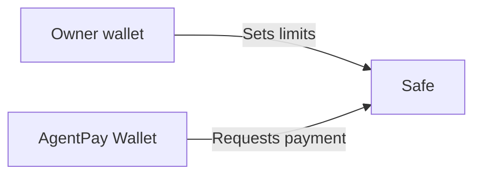

<h1 align="center">AgentPay User</h1>
<p align="center"><strong>Give your AI Agent useful Skills. Keep control of its spending.</strong></p>
<p align="center">
  <a href="https://agentpay.c4r.fun/">Explore Market</a> ·
  <a href="https://agentpay.c4r.fun/setup/user">Setup guide</a> ·
  <a href="https://github.com/c4rO-0/agentpay-user/blob/main/doc/README.md">Documentation</a>
</p>

User runs the connection between your AI Agent's Skills and paid services. Set a
budget in your Safe, approve it with your owner wallet, and let eligible purchases
run within those limits. The matching local Wallet is installed automatically.

## Get started

**Linux · Node.js 22.22.3+ · npm**

Start with the [official AgentPay Market](https://agentpay.c4r.fun/) to discover
Skills and services. Its [setup guide](https://agentpay.c4r.fun/setup/user) explains
Safe and owner addresses and provides commands for the current platform.

```sh
npm install --global @c4roa0/agentpay-user
agentpay install --market https://agentpay.c4r.fun
```

Use a user-owned Node/npm installation. The guide downloads public settings,
prepares User and Wallet, and asks you to approve spending limits with your Safe
owner wallet. **Never enter your owner private key into AgentPay.**

Using another AgentPay platform? Replace the URL with its HTTPS Market origin.
The official address is a convenient starting point, not a built-in service dependency.

<details>
<summary><strong>Prefer installing in a folder?</strong></summary>

```sh
mkdir agentpay-local
cd agentpay-local
npm install @c4roa0/agentpay-user
./node_modules/.bin/agentpay install --market https://agentpay.c4r.fun
```

Use `./node_modules/.bin/agentpay` for subsequent commands. Updates remain local to
this installation. Private Wallet data stays outside this program folder. Before
removing the folder, use `uninstall` to remove its managed services.

</details>

### Fund your Safe



During setup, use your owner wallet (such as MetaMask) to approve the limits.
AgentPay Wallet then uses its local Session Key to request purchases within them.
Each payment comes from the **Safe balance**.

On Base, transfer USDC to your **Safe account** before the first paid test.
Run `agentpay wallet info` to copy that address.

## After setup

| Task | Command |
| --- | --- |
| Check your installation | `agentpay status` |
| Unlock after a restart | `agentpay wallet unlock` |
| Connect this Wallet to Market | `agentpay market connect` |
| View saved Orders | `agentpay orders list` |
| Check the complete payment path | `agentpay payment test` |
| Review and apply an update | `agentpay update` |

Setup offers to connect your Wallet to Market, then asks whether to run the paid test. Use `agentpay setup` to resume.

The optional payment test uses the official random-number Skill. It is a **paid
request**, with its current price shown before confirmation. Installing or updating
User does not authorize a purchase. If a request is interrupted, preserve its
records and resume it rather than buying again.

Linux services use your systemd user session. Only one installation's Wallet and
Runtime pair runs at a time; switching installations requires confirmation.
Run `agentpay health` for diagnostics you can share with support.

## Your data stays with you

Keys, Policies, Orders and cache normally live in `~/.local/share/agentpay/user`;
installation state lives in `~/.local/state/agentpay/user`. Custom locations are
retained. `agentpay wallet info` shows the actual paths. Back up private data and
your unlock password; do not upload them to Market or send them to support.

[First use](doc/runbooks/user-onboarding.md) · [Updates](doc/runbooks/local-update.md) ·
[Backup and recovery](doc/runbooks/wallet-identity.md) · [Emergency stop](doc/runbooks/emergency-payment-stop.md)

## Build with User

Clone or download this repository, run `npm ci`, then use `./run help`. Wallet and
Protocol come from pinned npm dependencies; no sibling checkout is required.
`npm link` optionally exposes your checkout as `agentpay`.

[Developer guide](doc/develope.md) · [Skill integration](doc/runbooks/runtime-skill-client.md) ·
[Architecture](doc/architecture.md) · [Contributing](CONTRIBUTING.md) · [Progress](progress.md)

**Scope:** Linux is verified; macOS startup remains unverified. Local tests and
Anvil rehearsals do not prove mainnet financial readiness. Locking Wallet or
disconnecting Market does not revoke on-chain permission.

**License:** [MPL 2.0](LICENSE). Wallet and Protocol retain their own licenses.
[Third-party notices](NOTICE.md) · [Security reporting](SECURITY.md)
